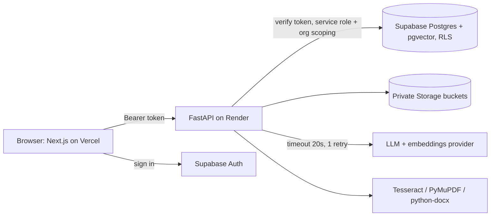

# BrandGuard architecture



## Data flow of one review

1. Creator submits text or a file. The file is parsed to text (PDF: PyMuPDF, DOCX: python-docx, image: Tesseract) and stored in a private bucket; a content item and version 1 are created.
2. **Layer A** (deterministic, no AI): YAML rules (`backend/rules`) run as regex, rapidfuzz terminology matching, structural checks (contradictory disclaimer, missing `#Ad`, AI label, alt-text) and a WCAG contrast check on image regions. Findings have exact spans and `confidence=high`.
3. **Retrieval**: approved guideline and fact chunks for the org: pgvector top-k when embeddings work, keyword overlap otherwise.
4. **Layer B** (grounded AI): the model receives only the retrieved sources and returns JSON validated by pydantic. Citations outside the retrieved set are downgraded to *Unsupported claim* (confidence low); spans that cannot be located in the text are dropped. With no key, or on timeout or error, an offline heuristic produces the same JSON shape and goes through the same checks (`used_fallback = true`, visible notice).
5. **Merger**: overlapping findings (IoU >= 0.5) merge and citations are unioned; severity is the max and rises to high when a regulatory source is cited; ordered high severity first, then by position.
6. Findings, a `review_runs` row and audit events are persisted. The UI streams progress over SSE.
7. The creator accepts, edits or rejects each finding. A new version is built **only** from accepted replacements and edited text, then re-checked automatically.

## Why two layers
Rules are fast, free, exact and explainable, and regulators care about the exact phrases. AI handles what rules cannot (fact comparison, tone) but is constrained: retrieved sources only, validated output, labelled low confidence when unsupported. If AI is down, the product still works.

## Workflow state machine (`backend/app/workflow/state_machine.py`)
```
draft --review--> checked --submit(creator)--> pending_manager ("In review")
pending_manager --approve(manager)--> approved
pending_manager --request_changes(manager, reason)--> changes_requested --new version--> checked
pending_manager --escalate(manager)--> escalated
escalated --approve(reviewer; override reason if high-severity findings unresolved)--> approved
escalated --reject(reviewer, reason)--> rejected --new version--> checked
```
Pure functions, tested for every legal and illegal transition. Each transition writes an `approvals` row and an audit row.

## Security model
- Four roles enforced in the API (`require_roles`, state machine) and, for sources, in RLS. The UI hides forbidden actions but is never the only guard.
- `org_id` always comes from the caller's profile, never from the client; every table has `org_id` with RLS (`002_workflow.sql` adds role-aware source policies and org-scoped storage paths).
- `audit_log` is append-only (trigger in SQL; `MemoryStore` refuses updates). Buckets are private. `SUPABASE_SERVICE_KEY` and `LLM_API_KEY` exist only in the backend.

## Key decisions
- **pgvector with keyword fallback**: retrieval never blocks the demo.
- **Human in the loop**: suggestions carry an explicit `replacement`; nothing changes text until a creator decides and saves a version.
- **Two stores behind one interface** (`backend/app/store.py`): `SupabaseStore` in production, seeded `MemoryStore` for offline demos and tests, so the whole app runs with zero setup.
- **RLS as defence in depth**: the API uses the service role and scopes by org in code; RLS protects direct client access.
